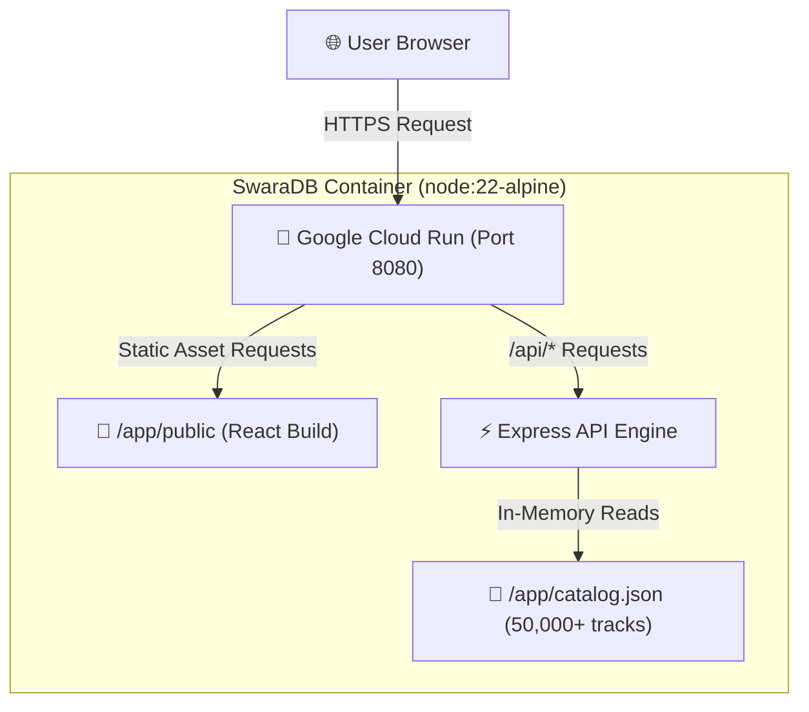

# SwaraDB – GCP Console (GUI) Deployment Guide

This guide provides step-by-step instructions for packaging and deploying **SwaraDB** to **Google Cloud Run** using the **Google Cloud Console (GUI)**.

---

## 🏗️ Packaging & Architecture Overview

SwaraDB is packaged as a **single container** combining the compiled React frontend static files (`client/dist`) and the Express API server (`server/index.js`), backed by the baked-in `catalog.json` database.



### Verified Build Artifacts
- **Frontend Build**: Compiled via Vite into `client/dist/` (HTML, JS bundle, RYM CSS theme).
- **Database Catalog**: Exported into `assets/catalog.json` (198 KB, 200 artists, 5,812 albums, 50,007 songs).
- **Container Definition**: `Dockerfile` at repository root.

---

## 📋 Pre-Deployment Checklist

Before opening the GCP Console, ensure you have:
1. A **Google Cloud Platform (GCP)** account with an active billing project.
2. The project source code directory (`swaradb`).
3. `assets/catalog.json` populated.

---

## 🚀 Step-by-Step GCP Console (GUI) Deployment

### Step 1: Select Project & Enable Required APIs

1. Open the [Google Cloud Console](https://console.cloud.google.com/).
2. In the top navigation bar, select your **GCP Project** (or create a new one).
3. In the left navigation menu, go to **APIs & Services > Library**.
4. Search for and **Enable** the following 3 APIs:
   - **Cloud Run API**
   - **Artifact Registry API**
   - **Cloud Build API**

---

### Step 2: Create Artifact Registry Repository (GUI)

1. Navigate to **Artifact Registry > Repositories** in the GCP Console.
2. Click **+ CREATE REPOSITORY** at the top.
3. Configure repository settings:
   - **Name**: `swaradb`
   - **Format**: `Docker`
   - **Mode**: `Standard`
   - **Location type**: `Region` (Select your preferred region, e.g., `asia-south1` or `us-central1`).
   - **Encryption**: `Google-managed encryption key`.
4. Click **CREATE**.

> [!NOTE]
> Your repository URL will look like:
> `asia-south1-docker.pkg.dev/YOUR_PROJECT_ID/swaradb`

---

### Step 3: Build & Push Image via Cloud Shell (GUI Terminal)

1. Click the **Activate Cloud Shell** icon (`>_`) in the top-right GCP Console header bar.
2. Upload your project folder or clone your repository into Cloud Shell:
   ```bash
   cd swaradb
   ```
3. Submit the build to Cloud Build using the pre-configured `cloudbuild.yaml`:
   ```bash
   gcloud builds submit --config cloudbuild.yaml --substitutions=_REGION="asia-south1" .
   ```
4. Wait for the build to finish. Cloud Build will output your container image tag:
   `asia-south1-docker.pkg.dev/YOUR_PROJECT_ID/swaradb/swaradb:latest`

---

### Step 4: Deploy to Cloud Run via GCP Console GUI

1. Navigate to **Cloud Run** in the GCP Console menu.
2. Click **+ CREATE SERVICE**.
3. Select **Deploy one revision from an existing container image**.
4. Click **SELECT** under Container image URL:
   - Expand your Artifact Registry repository (`swaradb`).
   - Select the `swaradb:latest` or specific `$BUILD_ID` image.
5. Configure Service Settings:
   - **Service name**: `swaradb`
   - **Region**: Select the same region (e.g., `asia-south1`).
   - **Ingress control**: `All` (Allow direct internet traffic).
   - **Authentication**: Select **Allow unauthenticated invocations** (Public web access).
6. Expand **Container, Volumes, Networking, Security**:
   - **Container port**: Set to `8080`.
   - **Capacity**:
     - **Memory**: `512 MiB`
     - **CPU**: `1`
   - **Autoscaling**:
     - **Minimum number of instances**: `0` (Scales to zero when idle to save costs).
     - **Maximum number of instances**: `3` (Prevents runaway costs).
7. Click **CREATE**.

---

### Step 5: Verification & Access

1. Once deployment completes, Cloud Run will display a green checkmark next to your service.
2. Copy the generated service URL at the top (e.g. `https://swaradb-xyz-el.a.run.app`).
3. Click the link to open your live **SwaraDB** RateYourMusic-style application!

> [!TIP]
> **Custom Domain Mapping**: To map a custom domain (e.g. `music.example.com`), go to **Cloud Run > Manage Custom Domains** in the GCP Console UI and follow the DNS CNAME record prompt.

---

## ⚙️ Container Environment Configuration Reference

| Environment Variable | Default Value | Description |
| :--- | :--- | :--- |
| `PORT` | `8080` | Port listening for HTTP traffic in Cloud Run |
| `NODE_ENV` | `production` | Enables production optimizations for Express |
| `CATALOG` | `/app/catalog.json` | Path to the baked-in JSON catalog |
| `PUBLIC_DIR` | `/app/public` | Path to static compiled React build files |

---

## 🔍 Health Check & Troubleshooting

- **Health Endpoint**: The container includes an explicit healthcheck route at `/healthz`.
- **Viewing Logs**: Go to **Cloud Run > swaradb > Logs** tab in GCP Console to view live Express logs and HTTP request traces.
